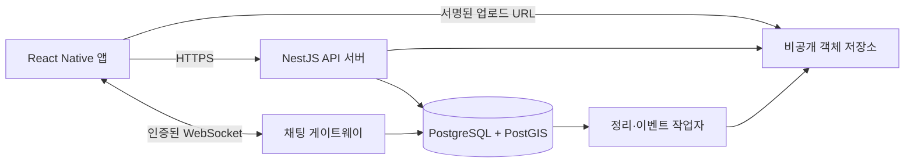

# 곤충맵 TDD — 기술 의사결정 및 백엔드 설계

| 항목 | 내용 |
|---|---|
| 문서 상태 | 설계 초안 v0.2 · 로그인 웹 화면·번들·타입 검사 검증 완료, 기기 검증 전 |
| 작성일 | 2026-11-06 |
| 연결 요구사항 | [PRD](./PRD.md) |
| 결정 상태 | React Native·NestJS는 사용자 선택; DB와 나머지 기술 선택은 **권장안**이며 구현 전 |

## 1. 설계 범위와 원칙

사용자가 직접 요청한 것은 사진 필수 곤충 발견·채집 기록, 지도 마커와 타인의 조회, 작성자 채팅, 자유게시판, 무료·유료 분양 게시판이다. 첫 출시 플랫폼은 모바일 앱이며 프론트엔드는 React Native, 백엔드는 NestJS로 정했다. iOS·Android를 동시에 출시할지는 미정이다. 현재 작업 폴더에는 로그인 UI와 Expo 설정 파일이 있으며 웹 번들과 타입 검사는 완료했다. 실제 기기 실행·캡처는 미검증이다. 백엔드와 기존 인프라는 없으므로 DB·API·스키마의 세부 내용은 **구현을 위한 제안**이다.

설계의 중심은 다음 네 가지다.

1. 지도 화면에 필요한 공개 기록만 영역과 필터로 조회한다.
2. 사진 업로드와 기록 저장의 실패·재시도에서 중복 또는 사진 없는 기록을 막는다.
3. 정확한 발견 좌표와 공개 좌표를 분리한다.
4. 채팅은 서버 저장을 기준으로 복구하며, 클라이언트 중복 전송을 식별한다.

## 2. 기술 결정 요약

| ID | 결정 및 상태 | 이유 | 대안·재검토 조건 |
|---|---|---|---|
| TD-01 | **채택:** React Native 앱 + NestJS 백엔드; 백엔드는 모듈형 단일 서비스로 시작 | 사용자가 지정한 앱·서버 기술을 기준으로 지도·게시판·채팅 기능을 분리한다. | 서비스 분리는 운영 규모와 팀 구성이 정해지면 재검토. |
| TD-02 | **권장:** PostgreSQL + PostGIS | 지도 영역 조회에 공간 인덱스를 쓰고, 기록·사진·채팅·분양의 관계 및 트랜잭션을 한 DB에서 관리한다. | 좌표 조회가 단순한 초소형 시제품이라면 일반 PostgreSQL 좌표 컬럼으로 시작 가능하나, 지도 필터 확장 전에 재설계 필요. |
| TD-03 | **권장:** 객체 저장소에 사진, DB에 메타데이터 | 큰 파일을 DB 트랜잭션에서 분리한다. | 작은 프로토타입에서 직접 업로드 가능. 배포 전 접근 제어와 정리 작업 필요. |
| TD-04 | **권장:** HTTP API + 인증된 WebSocket 채팅 | 기록·게시판은 요청/응답, 메시지는 실시간 이벤트에 맞다. | 연결 안정성이 낮다면 HTTP 폴링으로 시작 가능. |
| TD-05 | **권장:** 지도 SDK의 클라이언트 클러스터링으로 시작 | 초기 구현이 단순하고 현재 영역 조회와 결합 가능하다. | 실제 데이터·기기 측정에서 느리면 서버 격자 집계로 전환. |
| TD-06 | **권장:** 정확/대략 공개 선택, 기본 대략 공개 | 민감한 발견 지점을 보호한다. | 공개 해상도와 기본값은 제품 결정 필요. |
| TD-07 | **권장:** 유료 분양은 가격 표시 + 채팅 문의 | 사용자가 요청한 게시판 범위를 충족한다. | 결제·배송·정산은 별도 제품/운영 결정 후 설계. |
| TD-08 | **권장:** 앱 전용 세션 + OS 보안 저장소 | 앱 토큰을 브라우저 쿠키나 일반 앱 저장소에 의존하지 않는다. | 웹 버전을 만들 때는 별도 쿠키 세션 설계. |
| TD-09 | **권장:** 카카오·Google 공통, iOS에 Apple 추가 | 두 OS에서 같은 제공자로 다시 로그인할 수 있고 iOS 로그인 선택지도 마련한다. | 출시 OS와 대상 사용자층이 정해지면 버튼 수를 조정. |
| TD-10 | **프론트 초기 선택:** Expo SDK 58 + TypeScript, React 19.3 / React Native 0.88.1 | 2026-11-09 로그인 UI 작업에서 공식 SDK 표·템플릿 기준으로 설정했다. Expo Go·웹에서 공통 화면을 확인할 기반이며 사용자 확정 기술인 React Native를 유지한다. | 웹 번들·타입 검사는 통과했다. 네이티브 기기 실행은 미검증이며 Expo 호환성 확인은 오프라인 로컬 맵에서 SVG 패치 버전 차이를 보고했다. |
| TD-11 | **채택:** UI 아이콘은 `lucide-react-native` 컴포넌트로 표시하고 `react-native-svg`를 렌더러로 사용한다. 아이콘 모양 선택은 [Lucide 아이콘 카탈로그](https://lucide.dev/icons)를 기준으로 한다. | 사용자가 Figma 아이콘을 사용하지 말고 Lucide를 기준으로 선택하라고 요청했다. 트리 셰이킹되는 React Native 컴포넌트로 개별 아이콘만 불러온다. | 실제 Expo 호환성은 네트워크가 복구된 뒤 설치 및 번들로 검증한다. |

### 프론트 초기 구현 상태 · 2026-11-09

- 루트 `package.json`·`app.json`·`tsconfig.json`·`index.ts`·`App.tsx`에 Expo 앱 설정과 실행 명령을 작성했다. 네이티브 폴더는 아직 생성하지 않았다. 서버는 이번 UI 요청에 포함하지 않는다.
- `src/features/auth`에 선택 Figma `2:3`의 로그인 UI와 소개 카드, Lucide 아이콘 매핑 및 `src/theme/tokens.ts`의 화면 토큰을 둔다. 화면에서 사용하는 아이콘 에셋은 로컬 Figma 이미지가 아니라 Lucide 컴포넌트다.
- 안전 영역은 `react-native-safe-area-context`로 처리하고 시스템 상태바를 사용한다. 화면 전체를 세로 스크롤하도록 구성해 작은 화면에서 입력 동작이 잘리는 것을 피한다. 실제 기기 검증은 후속 과제다.
- 소셜·이메일·비회원 버튼은 미연동 및 접근성 비활성 상태다. 인증 SDK·API·토큰 저장·비회원 탐색은 구현하지 않았다. 약관도 실제 정책 문서로 연결하지 않았다.
- 선택 시안의 네이버 제공자는 TD-09의 권장 Google과 다르다. 이번 화면 작업은 시안의 버튼을 재현했으며 인증 제공자 결정이나 PRD 범위 변경으로 간주하지 않는다.
- 현재 설치 버전은 `lucide-react-native@1.70.0`, `react-native-svg@15.16.0`이다. `npm run typecheck`, `npm run export:web`, `npx expo install --check`는 2026-11-09에 통과했다. Expo 의존성 검사는 오프라인 로컬 호환성 표를 사용했다. Ego Browser로 `http://127.0.0.1:8081` 모바일 화면을 확인하고 [구현 캡처](../design/login/implementation.png)를 저장했다. 소개 인디케이터의 스크롤과 수정 후 개발 모드 앱 콘솔 오류 0건을 확인했다. 실제 기기 실행은 미검증이다.
- 장식 아이콘 접근성은 플랫폼별로 처리한다. 웹 SVG에는 `aria-hidden`, 네이티브에는 `accessible={false}`를 전달한다. 네이티브 전용 `accessible` 값을 웹 DOM에 전달하면 React의 비 boolean DOM 속성 오류가 발생한다.
- 버전 근거: [Expo SDK 호환 표](https://docs.expo.dev/versions/latest/), [SDK 58 템플릿](https://github.com/expo/expo/blob/sdk-58/templates/expo-template-blank-typescript/package.json), [안전 영역 설정](https://docs.expo.dev/versions/latest/sdk/safe-area-context/).

지도 제공자, iOS·Android 출시 순서, 호스팅 및 객체 저장소 공급자는 미정이다. 아래 인터페이스는 공급자 교체가 가능하도록 정의한다. Redis는 초기 필수 저장소가 아니다. 채팅의 다중 인스턴스 이벤트 전달이나 캐시가 실제로 필요해질 때 추가한다.

## 3. 시스템 구조



**서버 모듈:** 인증/사용자, 발견 기록, 미디어, 지도 조회, 자유게시판, 분양, 채팅, 운영 작업. API 서버와 채팅 게이트웨이는 같은 배포 단위로 시작할 수 있다. 다중 인스턴스에서 실시간 이벤트 전달이 필요해지면 메시지 브로커를 추가한다.

**앱 로그인 상태:** 제공자 인증을 우리 서버의 앱 세션으로 교환한다. 짧은 수명의 앱 액세스 토큰은 메모리에 두고, 갱신 토큰은 iOS Keychain 또는 Android Keystore로 보호되는 앱 전용 암호화 저장소에 둔다. React Native의 일반 `AsyncStorage`에 토큰을 평문 저장하지 않는다. 쿠키는 향후 웹 버전의 세션 설계 대상이며 모바일 앱의 기본 저장 방식으로 사용하지 않는다.

**요청 경계:** 클라이언트가 보낸 좌표·가격·작성자 ID를 신뢰하지 않는다. 작성자는 인증 정보에서 정하고, 지도 조회에는 `public_location`만 사용한다. 사진 파일은 비공개 저장소에 두고 짧은 수명의 읽기 URL 또는 이미지 프록시로 제공한다.

## 4. 데이터 모델

### 4.1 관계 요약

| 테이블 | 주요 데이터 | 관계·불변식 |
|---|---|---|
| `users` | 서비스 내부 계정 ID, 표시 이름, 상태 | 작성자·대화 참여자의 기준 |
| `user_identities` | 제공자와 제공자 사용자 ID | 여러 소셜 계정을 한 서비스 계정에 명시적으로 연결 |
| `app_sessions` | 갱신 토큰 해시, 만료·폐기 상태 | 기기별 세션 갱신·로그아웃 |
| `media_assets` | 객체 키, 소유자, 형식, 크기, 업로드 상태 | 본인 업로드만 콘텐츠에 연결 |
| `sightings` | 곤충명, 관찰/채집, 발견 시각, 설명, 정확/공개 좌표 | 작성자 소유; 삭제는 연관 대화 보존을 위해 soft delete |
| `sighting_photos` | 기록별 사진과 순서 | 공개 기록당 사진 최소 1장; 동일 자산 중복 연결 금지 |
| `free_posts`, `free_post_comments` | 자유게시글과 댓글 | 작성자 소유 |
| `adoption_listings` | 무료/유료, 가격, 상태, 지역 | 무료는 0원, 유료는 양수 |
| `chat_rooms` | 문의 대상 기록 또는 분양 글, 작성자와 문의자 | 방당 대상은 정확히 하나, 대상·문의자별 방 하나 |
| `chat_messages` | 메시지, 보낸 사람, 클라이언트 요청 ID | 방 참여자만 전송; 재시도 중복 방지 |
| `idempotency_requests` | 생성 요청 키와 응답 | 재전송 시 같은 결과 반환 |
| `outbox_events` | 사진 삭제 등 후속 작업 | DB 커밋 이후 외부 작업 재시도 |

### 4.2 PostgreSQL 스키마 초안

실제 마이그레이션의 출발점이다. `created_at`은 서버 기록 시각이며 `occurred_at`은 사용자가 입력한 **발견 시각**이다. 좌표 입력은 API에서 경도 `-180..180`, 위도 `-90..90`을 검증한다. 시간 입력은 UTC로 저장하고 화면에서 사용자 시간대로 변환한다.

```sql
CREATE EXTENSION IF NOT EXISTS pgcrypto;
CREATE EXTENSION IF NOT EXISTS postgis;

CREATE TABLE users (
  id uuid PRIMARY KEY DEFAULT gen_random_uuid(),
  display_name text NOT NULL,
  status text NOT NULL DEFAULT 'active'
    CHECK (status IN ('active', 'suspended', 'deletion_pending', 'deleted')),
  created_at timestamptz NOT NULL DEFAULT now(),
  deleted_at timestamptz
);

CREATE TABLE user_identities (
  provider text NOT NULL CHECK (provider IN ('kakao','apple','google')),
  provider_user_id text NOT NULL,
  user_id uuid NOT NULL REFERENCES users(id),
  linked_at timestamptz NOT NULL DEFAULT now(),
  PRIMARY KEY (provider, provider_user_id),
  UNIQUE (user_id, provider)
);

CREATE TABLE app_sessions (
  id uuid PRIMARY KEY DEFAULT gen_random_uuid(),
  user_id uuid NOT NULL REFERENCES users(id),
  refresh_token_hash text NOT NULL UNIQUE,
  expires_at timestamptz NOT NULL,
  revoked_at timestamptz,
  created_at timestamptz NOT NULL DEFAULT now(),
  rotated_at timestamptz NOT NULL DEFAULT now()
);

CREATE TABLE media_assets (
  id uuid PRIMARY KEY DEFAULT gen_random_uuid(),
  owner_id uuid NOT NULL REFERENCES users(id),
  object_key text NOT NULL UNIQUE,
  mime_type text NOT NULL CHECK (mime_type IN ('image/jpeg','image/png','image/webp')),
  byte_size bigint NOT NULL CHECK (byte_size > 0),
  status text NOT NULL DEFAULT 'pending'
    CHECK (status IN ('pending','uploaded','attached','delete_pending')),
  expires_at timestamptz NOT NULL,
  created_at timestamptz NOT NULL DEFAULT now()
);

CREATE TABLE sightings (
  id uuid PRIMARY KEY DEFAULT gen_random_uuid(),
  author_id uuid NOT NULL REFERENCES users(id),
  species_label text,                -- NULL은 '이름 모름'
  kind text NOT NULL CHECK (kind IN ('observed','collected')),
  occurred_at timestamptz NOT NULL,
  description text NOT NULL DEFAULT '',
  location_visibility text NOT NULL
    CHECK (location_visibility IN ('exact','approximate')),
  exact_location geometry(Point,4326) NOT NULL,
  public_location geometry(Point,4326) NOT NULL,
  created_at timestamptz NOT NULL DEFAULT now(),
  updated_at timestamptz NOT NULL DEFAULT now(),
  deleted_at timestamptz
);

CREATE TABLE sighting_photos (
  sighting_id uuid NOT NULL REFERENCES sightings(id),
  media_asset_id uuid NOT NULL UNIQUE REFERENCES media_assets(id),
  sort_order integer NOT NULL CHECK (sort_order >= 0),
  PRIMARY KEY (sighting_id, media_asset_id),
  UNIQUE (sighting_id, sort_order)
);

CREATE TABLE free_posts (
  id uuid PRIMARY KEY DEFAULT gen_random_uuid(),
  author_id uuid NOT NULL REFERENCES users(id),
  title text NOT NULL,
  body text NOT NULL,
  created_at timestamptz NOT NULL DEFAULT now(),
  updated_at timestamptz NOT NULL DEFAULT now(),
  deleted_at timestamptz
);

CREATE TABLE free_post_comments (
  id uuid PRIMARY KEY DEFAULT gen_random_uuid(),
  post_id uuid NOT NULL REFERENCES free_posts(id),
  author_id uuid NOT NULL REFERENCES users(id),
  body text NOT NULL,
  created_at timestamptz NOT NULL DEFAULT now(),
  deleted_at timestamptz
);

CREATE TABLE adoption_listings (
  id uuid PRIMARY KEY DEFAULT gen_random_uuid(),
  author_id uuid NOT NULL REFERENCES users(id),
  title text NOT NULL,
  species_label text,
  description text NOT NULL,
  region_label text NOT NULL,
  listing_type text NOT NULL CHECK (listing_type IN ('free','paid')),
  price_krw integer NOT NULL CHECK (price_krw >= 0),
  status text NOT NULL DEFAULT 'available'
    CHECK (status IN ('available','reserved','completed')),
  created_at timestamptz NOT NULL DEFAULT now(),
  updated_at timestamptz NOT NULL DEFAULT now(),
  deleted_at timestamptz,
  CHECK ((listing_type = 'free' AND price_krw = 0)
      OR (listing_type = 'paid' AND price_krw > 0))
);

CREATE TABLE adoption_photos (
  listing_id uuid NOT NULL REFERENCES adoption_listings(id),
  media_asset_id uuid NOT NULL UNIQUE REFERENCES media_assets(id),
  sort_order integer NOT NULL CHECK (sort_order >= 0),
  PRIMARY KEY (listing_id, media_asset_id),
  UNIQUE (listing_id, sort_order)
);

CREATE TABLE chat_rooms (
  id uuid PRIMARY KEY DEFAULT gen_random_uuid(),
  sighting_id uuid REFERENCES sightings(id),
  listing_id uuid REFERENCES adoption_listings(id),
  owner_id uuid NOT NULL REFERENCES users(id),
  requester_id uuid NOT NULL REFERENCES users(id),
  created_at timestamptz NOT NULL DEFAULT now(),
  CHECK ((sighting_id IS NOT NULL) <> (listing_id IS NOT NULL)),
  CHECK (owner_id <> requester_id)
);

CREATE UNIQUE INDEX uq_room_sighting_requester
  ON chat_rooms (sighting_id, requester_id) WHERE sighting_id IS NOT NULL;
CREATE UNIQUE INDEX uq_room_listing_requester
  ON chat_rooms (listing_id, requester_id) WHERE listing_id IS NOT NULL;

CREATE TABLE chat_messages (
  id bigint GENERATED ALWAYS AS IDENTITY PRIMARY KEY,
  room_id uuid NOT NULL REFERENCES chat_rooms(id),
  sender_id uuid NOT NULL REFERENCES users(id),
  client_message_id uuid NOT NULL,
  body text NOT NULL,
  created_at timestamptz NOT NULL DEFAULT now(),
  UNIQUE (room_id, sender_id, client_message_id)
);

CREATE TABLE idempotency_requests (
  user_id uuid NOT NULL REFERENCES users(id),
  operation text NOT NULL,
  request_key text NOT NULL,
  request_hash text NOT NULL,
  response_status integer,
  response_body jsonb,
  created_at timestamptz NOT NULL DEFAULT now(),
  PRIMARY KEY (user_id, operation, request_key)
);

CREATE TABLE outbox_events (
  id bigint GENERATED ALWAYS AS IDENTITY PRIMARY KEY,
  event_type text NOT NULL,
  payload jsonb NOT NULL,
  created_at timestamptz NOT NULL DEFAULT now(),
  processed_at timestamptz
);

CREATE INDEX ix_sightings_public_location ON sightings USING gist (public_location)
  WHERE deleted_at IS NULL;
CREATE INDEX ix_sightings_occurred ON sightings (occurred_at DESC, id)
  WHERE deleted_at IS NULL;
CREATE INDEX ix_sightings_kind_time ON sightings (kind, occurred_at DESC)
  WHERE deleted_at IS NULL;
CREATE INDEX ix_chat_messages_room_id ON chat_messages (room_id, id);
CREATE INDEX ix_listings_status_created ON adoption_listings (status, created_at DESC)
  WHERE deleted_at IS NULL;
CREATE INDEX ix_media_cleanup ON media_assets (expires_at)
  WHERE status IN ('pending','uploaded','delete_pending');
CREATE INDEX ix_sessions_user_active ON app_sessions (user_id, expires_at)
  WHERE revoked_at IS NULL;
```

**스키마로만 강제하기 어려운 규칙:** 공개 기록과 분양 글에는 각각 사진 1장 이상이 있어야 한다. 생성은 사진 연결까지 **한 DB 트랜잭션**으로 처리하고, 커밋 전 서버에서 사진 수를 검증한다. DB에 대한 우회 쓰기까지 막으려면 `DEFERRABLE INITIALLY DEFERRED` 제약 트리거를 마이그레이션에 추가한다. `chat_rooms.owner_id`가 대상 글의 작성자인지, `chat_messages.sender_id`가 방의 두 참여자 중 하나인지도 트랜잭션에서 검사하고 통합 테스트로 검증한다. 분양 상태 전이(`available → reserved → completed`)는 서버에서 허용 경로를 검사한다.

미디어를 분양 글과 기록 사이에 재사용하지 않는 정책을 권장한다. 같은 객체 키의 중복 연결은 서비스에서 거부하고, 필요 시 별도 공통 소유 테이블로 강화한다.

## 5. 주요 API 계약 초안

| 방법·경로 | 역할 | 핵심 입력/출력 |
|---|---|---|
| `POST /v1/auth/exchange` | 소셜 로그인 교환 | 제공자와 검증 가능한 제공자 자격 증명 → 앱 액세스·갱신 토큰, 내부 사용자 ID |
| `POST /v1/auth/refresh` | 앱 세션 갱신 | 갱신 토큰 → 회전된 새 토큰 쌍 |
| `POST /v1/auth/logout` | 현재 기기 로그아웃 | 현재 세션 폐기 |
| `GET /v1/auth/me` | 로그인 상태 확인 | 내부 사용자 정보 |
| `POST /v1/auth/identities` | 소셜 계정 연결 | 로그인된 사용자 + 새 제공자 인증 → 연결 결과 |
| `DELETE /v1/account` | 앱 내 계정 삭제 | 본인 재확인 후 계정 삭제 절차 시작·세션 폐기 |
| `POST /v1/media/upload-intents` | 업로드 예약 | 파일 형식·크기 → `mediaId`, 서명 URL, 만료 시각 |
| `POST /v1/media/{id}/complete` | 업로드 확인 | 객체 존재·크기·형식 확인 → `uploaded` |
| `POST /v1/sightings` | 기록 생성 | `Idempotency-Key`, 사진 ID들, 곤충명, 유형, 발견 시각, 경도·위도, 위치 공개 수준 → 기록 ID |
| `GET /v1/sightings?bbox=...` | 지도 조회 | 서·남·동·북 경계, 기간, 이름, 유형, 커서 → 공개 좌표·썸네일·발견 시각 요약 |
| `GET /v1/sightings/{id}` | 기록 상세 | 공개 좌표, 사진, 설명, 작성자, 실제 발견 시각 |
| `PATCH/DELETE /v1/sightings/{id}` | 본인 기록 변경 | 작성자 권한 검사 |
| `GET/POST /v1/posts` | 자유게시글 | 페이지 조회·작성 |
| `GET/POST /v1/posts/{id}/comments` | 댓글 | 페이지 조회·작성 |
| `GET/POST /v1/adoptions` | 분양 글 | 무료/유료·상태·지역 필터, 작성 |
| `PATCH /v1/adoptions/{id}/status` | 상태 변경 | 작성자만 변경 |
| `POST /v1/chat-rooms` | 문의방 열기 | 대상 `sightingId` 또는 `listingId` → 기존 또는 새 방 |
| `GET /v1/chat-rooms/{id}/messages?afterId=...` | 메시지 복구 | 메시지 ID 순서로 이어받기 |
| `POST /v1/chat-rooms/{id}/messages` | 메시지 저장 | `clientMessageId`, 본문 → 서버 메시지 ID |
| `WS /v1/chat` | 실시간 수신 | 인증 후 참여 방 구독, `message.created` 이벤트 |

`bbox`는 경도·위도 순서로 받으며 범위, 최대 크기, 조회 기간, 페이지 크기 상한을 검증한다. 타인용 응답에는 `exact_location`과 내부 `object_key`를 넣지 않는다. 오류 응답은 일관된 코드(`VALIDATION_ERROR`, `FORBIDDEN`, `NOT_FOUND`, `CONFLICT`, `UPLOAD_NOT_READY`)를 사용한다.

### 지도 조회 쿼리

```sql
SELECT id, species_label, kind, occurred_at,
       ST_X(public_location) AS longitude,
       ST_Y(public_location) AS latitude
FROM sightings
WHERE deleted_at IS NULL
  AND ST_Intersects(public_location, ST_MakeEnvelope(:west,:south,:east,:north,4326))
  AND occurred_at >= :from_at AND occurred_at < :to_at
  AND (:kind IS NULL OR kind = :kind)
ORDER BY occurred_at DESC, id DESC
LIMIT :page_size;
```

곤충 이름 필터는 초기에는 정규화한 표시 이름의 정확·접두 검색 중 제품 기준을 정해 적용한다. 데이터가 늘면 검색 전용 인덱스 또는 별도 종 사전을 검토한다. 날짜와 ID를 함께 쓰는 커서 페이지네이션을 적용하고, 세계 경계를 넘는 `bbox`는 두 범위로 나눠 조회한다. API에서 지나치게 넓은 범위와 큰 페이지를 제한한다. 클러스터는 초기에는 조회된 마커를 지도 SDK에서 묶는다.

## 6. 핵심 처리 흐름

### 6.1 모바일 앱 로그인·세션

1. 앱은 제공자 공식 iOS/Android SDK 또는 OS의 외부 인증 브라우저로 소셜 인증을 시작한다. 직접 OAuth 인가 코드 흐름을 구현한다면 PKCE와 `state`를 사용하고, 앱 내장 WebView에서 비밀번호를 받지 않는다.
2. 앱은 제공자 자격 증명을 `/auth/exchange`에 보낸다. 서버가 제공자에 따라 서명·발급자·대상·만료를 검증하거나 제공자 사용자 조회 API로 확인한다. 확인된 **제공자 고유 ID**로 `user_identities`를 찾고, 없으면 새 `users` 계정을 만든다. Google의 `sub`, Apple의 안정적인 사용자 식별자, Kakao의 서비스 사용자 ID를 사용하며 이메일을 계정 키로 쓰지 않는다.
3. 서버는 자체 앱 액세스 토큰(권장: 약 15분)과 불투명한 갱신 토큰(권장: 최대 30일)을 발급한다. 갱신 토큰의 해시만 `app_sessions`에 저장한다. 액세스 토큰에는 세션 ID를 넣고, 인증된 API 요청마다 해당 세션이 폐기되지 않았는지 확인해 로그아웃을 즉시 반영한다. 제공자 토큰은 서비스 로그인 검증 후 폐기하고, 제공자 API를 계속 쓸 필요가 생기면 별도 보관 정책을 정한다.
4. 앱은 액세스 토큰을 메모리에, 갱신 토큰을 OS 보안 저장소에 둔다. 앱 재실행 시 갱신 API로 새 액세스 토큰을 받는다. 갱신은 원자적으로 토큰을 회전시키며, 로그아웃·계정 삭제 시 서버 세션을 폐기하고 기기 저장 값을 지운다. 계정 삭제 작업은 연결된 제공자 식별자와 개인 데이터를 제거하고, 공개 기록의 보존·익명화 기준은 운영 정책에 맞춰 처리한다.
5. 다른 제공자를 연결할 때는 현재 로그인 계정과 새 제공자 인증을 모두 확인한다. 동일 이메일만으로 자동 병합하지 않고, 이미 다른 사용자에게 연결된 제공자 계정은 `CONFLICT`로 처리한다.

앱이 두 OS에 배포되면 카카오·Google을 공통 로그인 경로, Apple을 iOS의 추가 선택지로 권장한다. iOS에서 Kakao 같은 소셜 로그인을 제공할 때는 Apple 심사 지침 4.8의 동등한 로그인 옵션 요건을 확인한다. iOS·Android 간 계정 이동은 공통 제공자 로그인 또는 사용자가 승인한 계정 연결로 처리한다. Apple만 연결된 계정의 Android 이동에는 추가 연결 안내 또는 별도 계정 복구 경로가 필요하다.

### 6.2 사진 등록과 재시도

1. 로그인 사용자가 사진 업로드 예약을 요청한다. 서버가 파일 정책을 확인하고 본인 소유 `media_assets(pending)` 및 단기 서명 URL을 만든다.
2. 클라이언트가 객체 저장소에 업로드한 뒤 완료 API를 부른다. 서버가 실제 객체의 메타데이터를 확인하고 `uploaded`로 바꾼다.
3. 클라이언트가 고정 `Idempotency-Key`와 함께 기록 생성 요청을 보낸다. 서버는 동일 키의 요청 해시를 비교한다. 같은 요청의 재시도는 저장된 결과를 돌려주고 다른 본문의 키 재사용은 `CONFLICT`로 거부한다.
4. 한 DB 트랜잭션에서 본인 소유·업로드 완료·미사용 사진을 잠그고 확인한다. 기록과 사진 연결을 저장하고 사진 상태를 `attached`로 바꾼다. 사진 수가 0이면 롤백한다.
5. 저장 실패 후에도 업로드된 자산을 유효 기간 안에 재사용한다. 만료된 미연결 자산은 주기 작업으로 삭제한다. 기록 삭제 시 사진 삭제 이벤트를 outbox에 남기고, 참조가 없음을 재확인한 뒤 객체를 지운다.

**동시성:** 동일 멱등 키 요청은 유일성 제약과 행 잠금으로 한 건만 완료한다. 다른 키로 동일 사진을 연결하려는 요청은 미디어 행 잠금과 `sighting_photos.media_asset_id UNIQUE`로 차단한다.

### 6.3 공개 위치

작성자가 지도에서 지정한 좌표를 `exact_location`에 저장한다. `exact`를 선택하면 공개 좌표를 동일하게 하고, `approximate`를 선택하면 서버가 일정 격자의 중심점으로 변환해 `public_location`에 저장한다. **격자 크기는 제품 결정 전까지 미확정**이며 기본 대략 공개를 권장한다. 정확한 좌표는 작성자 본인에게만 응답하고, 관리자 접근은 별도 권한·감사 정책을 정한다. 지도 검색·클러스터·응답 모두 공개 좌표만 사용한다. 사진 EXIF 위치 정보도 공개 전 제거한다.

### 6.4 채팅 저장·동기화

1. 기록 또는 분양 글의 문의 버튼을 누르면 대상 작성자를 확인한다. 작성자 본인이 자기 글에 문의할 수 없다.
2. 대상 ID와 문의자 ID의 유일성 제약으로 기존 방을 반환하거나 방을 생성한다. 대상 글이 soft delete 되거나 분양 완료돼도 기존 방과 메시지는 유지한다.
3. 메시지 전송 시 서버가 방 참여자 권한, 길이와 내용을 검증한다. `client_message_id`가 이미 있으면 기존 메시지를 반환한다.
4. DB 커밋 후 실시간 이벤트를 전송한다. 이벤트를 받지 못한 클라이언트는 마지막 서버 메시지 ID 이후를 HTTP로 조회한다. 클라이언트는 서버 메시지 ID로 중복을 제거한다.

단일 인스턴스에서는 DB 저장 후 직접 이벤트를 보낼 수 있다. 다중 인스턴스 또는 전달 보장이 필요해지면 메시지 발행을 outbox와 브로커에 연결한다. WebSocket 전달 자체를 영속 저장의 근거로 삼지 않는다.

## 7. 보안·운영 결정

- 앱 액세스 토큰의 서명·대상·만료를 검증하고, 변경 API는 전부 인증을 요구한다. 지도·게시판 공개 조회의 익명 허용 여부는 제품 결정 사항이다. 일반 앱 저장소와 로그에 인증 토큰을 남기지 않는다.
- 모든 수정·삭제 API는 DB의 작성자/참여자 ID로 권한을 재검증한다. URL의 대상 ID만으로 접근을 허용하지 않는다.
- 사진 업로드 URL은 특정 객체 키·형식·크기·짧은 만료 시간에 묶는다. 서버는 완료 시 실제 객체를 확인하고, 이미지 변환 및 악성 파일 검사 단계를 배포 정책에 맞춰 둔다.
- 채팅, 기록 생성, 지도 조회에는 요청 빈도·페이지 크기 제한을 둔다. 로그에는 정확 좌표, 서명 URL, 인증 토큰, 메시지 본문을 남기지 않는다.
- 사용자 삭제·신고·차단·관리자 숨김·보관 기간은 운영 정책과 함께 결정한다. 무료/유료 분양의 게시 허용 기준은 출시 전에 별도로 확인한다.
- 백업과 복구 절차, 객체 저장소 수명 정책, 실패한 outbox 재시도·경보를 배포 준비 항목으로 둔다.

## 8. 검증 계획과 결정 게이트

| 검증 | 방법 | 통과 기준 |
|---|---|---|
| 모바일 로그인 | 카카오·Apple·Google의 첫 로그인, 취소, 만료, 재실행, 로그아웃을 지원 OS에서 확인 | 내부 사용자 매핑과 세션 복구·폐기가 일관됨 |
| 계정 연결 | 동일 이메일의 다른 제공자, 명시적 연결, 이미 연결된 제공자 계정 시도 | 이메일 자동 병합 없음; 충돌 시 기존 계정 보호 |
| 세션 보관 | 기기 저장소·앱 로그·백업·토큰 갱신 실패 확인 | 일반 저장소에 평문 토큰 없음; 폐기된 세션 재사용 불가 |
| 기록 원자성 | 사진 0장, 업로드 미완료, 타인 사진, DB 저장 실패를 주입 | 공개 기록에 사진 0장 없음; 타인 자산 연결 불가 |
| 멱등성 | 동일 키 동시 요청·응답 유실 후 재시도 | 기록 1개, 같은 응답; 본문 변경 시 충돌 |
| 공간 조회 | 밀집/겹침 데이터 100·1,000·5,000건, `EXPLAIN ANALYZE` 및 지도 표시 측정 | 올바른 영역 결과; 목표 지연은 기준 환경 정의 후 설정 |
| 공개 위치 | exact/approximate 등록 후 타인 API·로그·사진 점검 | 대략 공개의 정확 좌표가 노출되지 않음 |
| 채팅 | 전송 재시도, 실시간 이벤트 중복, 연결 단절·복구, 비참여자 조회 | 메시지 1건 저장·표시; 누락 복구; 비참여자 거부 |
| 분양 상태 | 무료·유료 가격과 상태 전이, 완료 뒤 기존 방 조회 | 스키마 제약 유지; 기존 대화 보존 |

**구현 전에 정할 것:** iOS·Android 출시 순서, 지도 SDK, 로그인 제공 범위, PostgreSQL + PostGIS 채택 여부, 공개 위치 해상도, 사진 한도, 운영 정책, 지도·채팅 성능 기준. 결정되면 이 표의 권장안을 `채택` 또는 `기각`으로 변경하고 근거와 날짜를 남긴다.

## 9. 결정 이력

| 날짜 | 항목 | 상태 |
|---|---|---|
| 2026-11-06 | 사용자 직접 요청과 이전 대화를 토대로 백엔드·스키마·API 초안 작성 | 제안; 구현·성능 검증 전 |
| 2026-11-06 | 첫 출시 플랫폼을 모바일 앱으로 반영하고 앱 세션·소셜 로그인·계정 연결 설계 추가 | 제안; iOS·Android 출시 순서 미정 |
| 2026-11-06 | React Native·NestJS를 사용자 선택으로 반영; PostgreSQL + PostGIS를 기본 DB로 권장 | 앱·서버 채택, DB 제안 |

## 10. 로그인 설계 참고 자료

- [OAuth 2.0 for Native Apps (RFC 8252)](https://datatracker.ietf.org/doc/html/rfc8252): 외부 인증 브라우저, 인가 코드 및 PKCE.
- [Apple App Review Guidelines 4.8](https://developer.apple.com/app-store/review/guidelines/): iOS 소셜 로그인 제공 시 동등한 로그인 옵션 요건.
- [Apple Keychain Services](https://developer.apple.com/documentation/security/adding-a-password-to-the-keychain), [Android Keystore](https://developer.android.com/privacy-and-security/keystore): 기기 보안 저장소.
- [Google OpenID Connect](https://developers.google.com/identity/openid-connect/openid-connect), [Kakao Login](https://developers.kakao.com/docs/ko/kakaologin/common): 제공자 식별자와 로그인 흐름.

## 11. 데이터베이스 제안 근거

PostgreSQL + PostGIS를 기본 DB로 권장한다. `sightings.public_location`의 GiST 공간 인덱스와 `ST_Intersects`를 조합하면 현재 지도 영역의 기록을 조회할 수 있다. 기록·사진·대화방·분양 글의 외래 키와 트랜잭션도 같은 관계형 DB에 둘 수 있다. [PostGIS 공간 인덱스 안내](https://postgis.net/documentation/faq/spatial-indexes/), [NestJS 데이터베이스 통합 안내](https://docs.nestjs.com/data/overview)
